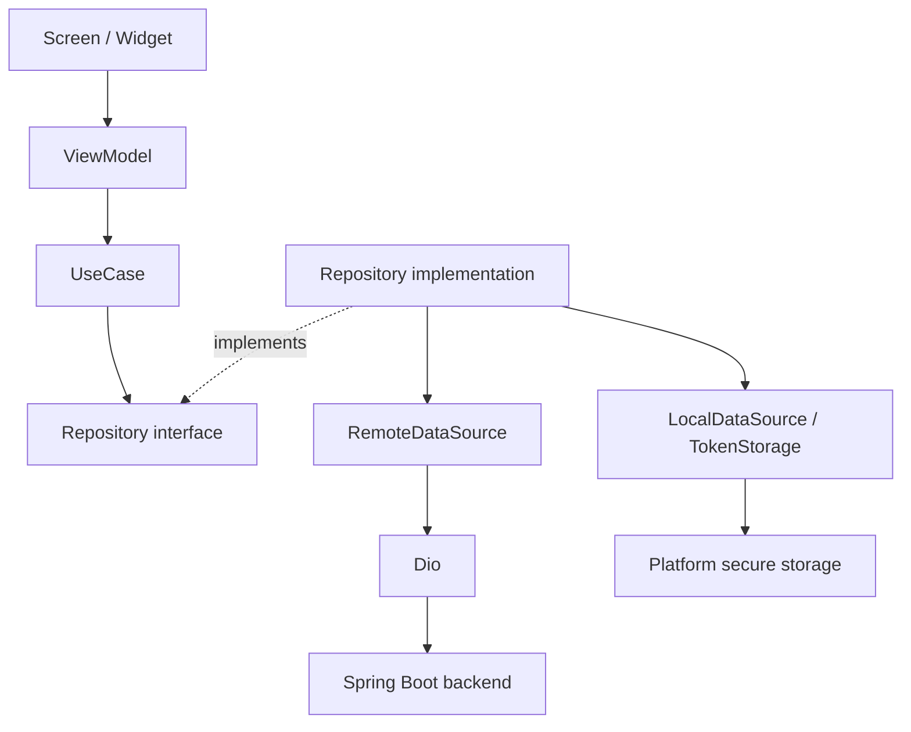
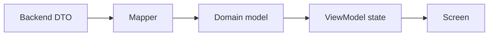
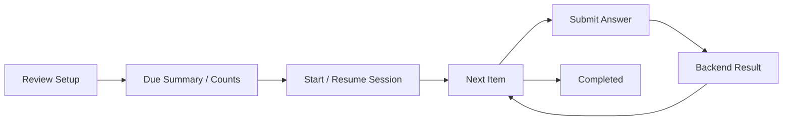
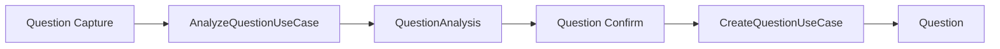

# Hatora mobile architecture

## Scope and repository discovery

This is the first **mobile foundation, architecture, and visual shell** implementation. The original project was the Flutter counter starter: `lib/main.dart`, one counter widget test, Flutter/Cupertino dependencies, default platform runners, and Flutter lint configuration. There was no router, networking, state management, token storage, or feature code to preserve. The starter screen/test were replaced; platform projects and lint configuration were retained. The directory has no Git metadata, so no commit or Git diff was available.

All source changes are inside this Flutter project. `../HatoraBackend` was read as reference only. Its `pom.xml`, Java source tree, and resources were accessible. The originally supplied prototype filename did not exist; the user identified the actual readable reference as `docs/design/hatora-prototip.html`.

## Dependency direction and responsibilities



- **Screen:** renders domain-backed presentation state, collects input, emits actions, and performs centralized navigation. It does not invoke repositories, parse JSON, hold tokens, or compute review rules. Text controllers, password visibility, and drawing gestures are local UI state.
- **ViewModel:** a Riverpod Notifier/AsyncNotifier owns one meaningful workflow. It calls injected use cases and exposes loading, success, and safe errors. No Dio, DTO, endpoint, or BuildContext is used in a ViewModel.
- **UseCase:** a single application action, depending on repository interfaces. `LoadQuestionCatalogUseCase` coordinates active-exam lookup and catalog loading. Image selection has a platform abstraction. Visual toggles have no use cases.
- **Repository interface:** exposes domain operations. **Implementation:** coordinates data sources, invokes pure mapping, and converts failures into `AppFailure`.
- **RemoteDataSource:** owns endpoint paths, request construction, multipart fields, JSON decoding, and DTO creation. Auth rotation uses a separate Dio instance to avoid interceptor recursion.
- **LocalDataSource:** `TokenStorage` abstracts token persistence; `SecureTokenStorage` writes one encrypted record through `flutter_secure_storage`.
- **DTO:** transport representation, confined to data. **Domain model:** the immutable subset needed by the app. **Mapper:** pure conversion, no I/O/navigation/widget dependencies. Small related DTOs/mappers live together where separate one-class files would add noise.



## Feature-first structure

```text
lib/
  app/                  application, composition root, routes, router, navigation shell
  core/
    config/             API_BASE_URL
    network/            Dio, auth interceptor, coordinated token rotation
    storage/            token persistence interface and secure implementation
    error/              typed failure and repository exception mapping
    theme/              semantic tokens and Material theme
    widget/             genuinely reusable visual components
  features/
    auth/               data / domain / presentation
    catalog/            data / domain / presentation
    onboarding/         data / domain / presentation
    home/presentation/  active-exam and goal shell
    question/           data / domain / presentation
  shared/drawing/       local scratchpad
```

Review is implemented as a real Phase 8 vertical slice. Statistics still uses an explicit coming-soon screen. Notebook browsing remains deferred although its backend exists.

## Riverpod and result/error handling

`app/providers.dart` is the composition root. It binds repository interfaces to data implementations and passes use cases into ViewModels through typed resolver callbacks. Tests override repository/platform providers without HTTP or platform channels. Screens read ViewModel providers, not repository providers.

`AuthViewModel` owns session restore/login/register/logout; `OnboardingViewModel` persists a single in-memory draft across three screens; capture and confirmation have separate ViewModels. Confirmation is an automatically disposed family keyed by its immutable navigation seed. `HomeViewModel` uses AsyncNotifier for read-only loading; topic search has a small presentation Notifier. Account changes invalidate account-specific state. A selected image and its analysis are retained during the active capture/confirmation workflow, not persisted to disk by the app.

Repository methods return domain values or throw typed `AppFailure`; there is no redundant custom Result wrapper alongside Riverpod's `AsyncValue`. Presentation states expose busy/data/failure or AsyncValue as appropriate. Repository exception mapping preserves stable error codes and field names from `details.fieldErrors`, but discards raw backend messages, rejected values, and traces. User-facing text is controlled by the app. Network, unauthorized, validation, not-found, conflict, business-rule, server, and unknown failures remain distinct. The backend remains authoritative; form validation is an early usability check based on inspected contracts.

## Routing

`Routes` centralizes paths. One retained `GoRouter` listens to session changes rather than being rebuilt on each state update. A ShellRoute hosts the five bottom-navigation destinations; tab changes use `go`, and capture/onboarding/detail interactions use `push`/`pop`. There are no parallel per-tab stacks in this initial scope.

Session redirects distinguish restoring, guest, authenticated/incomplete onboarding, and authenticated/complete onboarding. Guests may browse the public catalog and authentication screens. Incomplete users must finish onboarding before entering protected features. Completed users enter home. Confirmation/topic routes require in-memory domain arguments; a malformed/deep link safely returns to capture instead of crashing or inventing a draft. Draft restoration across process death is deliberately not claimed.

## Networking and token handling

Default API URL is `http://10.0.2.2:8080`, configurable through `API_BASE_URL`. Connect/send/receive timeouts are 15/30/60 seconds; the receive timeout allows the backend's bounded classification operation. There is no request-body or token logging.

The secure record stores both access and opaque refresh token together. Tokens do not enter widgets or ViewModel state. Auth/public catalog requests omit bearer credentials. Protected requests receive an access token only for the configured API origin. On a 401, one coordinated refresh flight rotates the token pair and a request is retried at most once. Delayed 401s from an old access token reuse the already rotated pair. Multipart retries clone FormData. A rejected refresh or rejected refreshed access invalidates the session; transient refresh/network failures retain secure credentials. Generation checks prevent retries crossing into another session. Logout waits for a current rotation and revokes the current refresh token; on an offline logout failure, the UI keeps the session so the user can retry revocation.

Session restore calls `/api/users/me` and lets the interceptor renew access when needed. A network failure during restore shows a retry state rather than silently treating the user as logged out. No Google/Apple auth or password-reset flow is fabricated.

## Backend contract discovery

Source inspection, not the HTML or speculative documentation, established the following. All paths are relative to the configured base URL.

| Area | Actual contract | Mobile use |
|---|---|---|
| Register | `POST /api/auth/register`: email, password, displayName → token pair | Connected |
| Login | `POST /api/auth/login`: email, password → token pair | Connected |
| Refresh | `POST /api/auth/refresh`: refreshToken → rotated pair | Connected, single flight |
| Logout | `POST /api/auth/logout`: refreshToken, allDevices → 204 | Connected, allDevices=false |
| Profile | `GET /api/users/me`: id, displayName, onboardingCompleted and other profile metadata | Connected; domain selects needed fields |
| Catalog | `GET /api/catalog/exams`, `/exams/{id}/editions`, `/exams/{id}/sections`, `/sections/{id}/subjects`, `/subjects/{id}/topics` | Connected, public |
| Onboarding | `GET /api/onboarding`; `POST /api/onboarding/complete`: examEditionId, dailyReviewGoal | Connected after authentication |
| Active exam | `GET /api/users/me/exams/active`; list and activate also exist | Inspected; mobile uses onboarding's activeExam response |
| Analysis | `POST /api/question-analyses`, multipart **file** → QuestionAnalysisResponse | Connected |
| Analysis read | `GET /api/question-analyses/{id}` | Inspected, deferred persisted analysis reload |
| Question creation | `POST /api/questions`, JSON confirmed draft → QuestionResponse | Connected |
| Question query/edit/archive | `GET /api/questions`, `GET/PATCH/DELETE /api/questions/{id}` | Inspected; deferred UI in this first pass |
| Solution images | `POST /api/questions/{id}/solution-images` multipart **file**; DELETE image and PATCH reorder | Inspected; deferred UI |
| File access | `GET /api/files/{*key}` requires JWT and owner check; unauthorized ownership looks like 404 | Inspected; current capture uses selected image bytes, never unauthenticated Image.network |

Register validation is email max 255, password 8–100, display name max 100; login requires nonblank email/password. Daily goal is 1–200. Catalog hierarchy is Exam → editions and sections → subjects → topics. `answerOptionCount` belongs to Exam, **not** the flattened UserExam response; the confirmation use case fetches the real catalog exam before displaying answers.

Analysis fields mapped: id, status, imageAccessUri, suggestedSectionId, suggestedSubjectId, suggestedTopicId, confidence, manualSelectionRequired, expiresAt. Supported persisted statuses: PENDING, COMPLETED, FAILED, CONFIRMED, EXPIRED. Confidence does not decide whether manual selection is required; the returned boolean is authoritative.

Creation sends analysisId, topicId, correctAnswer, mistakeReason, difficulty, shortNote, source. It never sends examId or subjectId. `analysisId` is nullable in the Java DTO but **required by QuestionCommandService in Phase 6**, because the image comes from an analysis. This is a documented backend distinction, not a contract invented by mobile. A FAILED analysis with a stored image can be manually confirmed. An upload/network failure with no returned analysis ID cannot bypass upload. Expired or consumed analyses return stable errors; the app exposes a new-image path for expiry and never automatically retries a create after an ambiguous transport failure.

Mistake reasons are exactly CARELESSNESS, CONCEPT_GAP, CALCULATION_ERROR, MISREAD, FORGOT_INFORMATION, TIME_PRESSURE, OTHER. Difficulty is HARD, MEDIUM, EASY. Short note max 2000; source max 500; correct answer max one character, validated against the exam by the server. The server verifies ownership, full active topic hierarchy, and initial review schedule. JPEG/PNG/WebP are accepted by the inspected image validator, with configurable 8 MB default limits and byte-signature validation. The picker requests a bounded image size and identifies the MIME type; the server still validates the upload.

The backend source now includes Phase 8 review-session and review-attempt APIs. Backend source code is the source of truth for these contracts. Review membership, correctness, results, stages, next-review dates, mastery, and automatic completion are server-authoritative; mobile only submits user intent and renders returned state. Dashboard and statistics endpoints remain deferred/not verified.



### Inspected backend files

Under `../HatoraBackend/src/main/java/com/hatora/backend/`:

- `auth/controller/AuthController.java`, all auth DTOs, `auth/service/AuthService.java`, `RefreshTokenService.java`.
- `security/config/SecurityConfig.java`; `user/controller/UserProfileController.java`, profile/preferences DTOs.
- `catalog/controller/CatalogController.java`, all response DTOs, `catalog/service/CatalogQueryService.java`.
- `onboarding/controller/OnboardingController.java`, both DTOs, `onboarding/service/OnboardingService.java`.
- `userexam/controller/UserExamController.java`, `UserExamResponse.java`, `ActiveExamContext.java`, `ActivateExamRequest.java`.
- `classification/controller/QuestionAnalysisController.java`, `dto/QuestionAnalysisResponse.java`, `entity/QuestionAnalysisStatus.java`, `service/QuestionAnalysisService.java`, `AnalysisConsumptionPortImpl.java`, `mapper/QuestionAnalysisMapper.java`.
- `question/controller/QuestionController.java`, `QuestionSolutionImageController.java`, question DTOs, `entity/Difficulty.java`, `MistakeReason.java`, `service/QuestionCommandService.java`, `QuestionQueryService.java`.
- `storage/controller/FileAccessController.java`, `storage/ImageUploadValidator.java`.
- `common/exception/ErrorCode.java`, `common/web/ApiError.java`, `FieldValidationError.java`, `PageResponse.java`.

Also inspected: `pom.xml`, resource/migration inventory, `application.yml`, Phase 8 review controllers, DTOs, services, assembler, mapper, enums, error codes, and `V8__review_sessions_attempts.sql`. Backend code was not run or changed.

## Prototype and design system

The HTML supplies navy ink, paper background, turquoise accents/gradients, soft status colors, rounded cards, optic answer bubbles, onboarding sequence, photo/analysis/confirmation intent, topic grouping, and bottom-navigation labels. These are semantic tokens in `AppColors`, not scattered hex literals. The first pass uses the platform sans-serif font with strong heading weights; exact Manrope/IBM Plex Sans assets are deliberately deferred, avoiding runtime font downloads.

Reusable components include PageBody, HatoraPrimaryButton, SelectableOptionCard, SectionHeader, AnswerOptions, LoadingView, ErrorView, EmptyView, and QuestionImageCard. SafeArea, a scrollable constrained content column, wrapping choices/buttons, keyboard resizing, and no fixed phone height support different phone sizes. No fake phone border, notch, 374×730 shell, or fake metrics are copied.

HTML JavaScript was not ported: DOM mutation, fake delayed analysis, sample questions, and client-side review grading violate the real mobile state/data boundaries. Home shows the actual exam/date and configured goal plus static encouragement, without a fabricated countdown, readiness score, critical mistake, or review count. Missing product sections show an explicit coming-soon state.

## Onboarding workflow

Exam selection loads real public exams and editions; no fake UUIDs or hardcoded available exams. One workflow ViewModel keeps the chosen edition, display, goal, and currentStep in memory while users move between selection, goal, and AI introduction. Pre-auth selections are never submitted. After login/register, the user explicitly saves the selections; the idempotent backend completion endpoint is called, profile is refreshed, and routing enters home. Existing completed users skip onboarding. Process-restart persistence of pre-auth selections is deferred.

## Question workflows



Capture abstracts camera/gallery and Android lost-data recovery. Selection does not upload automatically. States distinguish idle, selecting, imageSelected, analyzing, analysisSuccess, and analysisFailure. Cancellation keeps the previous selection. Backend AI failure and HTTP upload failure have different continuation paths.

Confirmation independently loads the authenticated active exam's catalog. A suggestion is offered for explicit acceptance, never silently assigned. Topic picker searches the already-loaded domain list locally, groups by real section/subject, and returns a Topic; it does not create questions. Confirmation owns required-field validation, catalog-derived answer choice count, user-selected reason/difficulty, note/source, submission state, and success. Duplicate taps are blocked. The server's returned first review date is displayed without recomputing scheduling.

## Review, statistics, drawing, and file integration

Review setup, filtered session creation/resumption, next-item loading, answer submission, and authoritative result rendering are connected to Phase 8. Correctness and scheduling are never evaluated on mobile. Statistics, metrics, notifications, and exports remain deferred. The local scratchpad supports normalized strokes, stroke eraser, undo, and clear, using a full-page drawing surface. It has no repository/use case, persistence, or scoring role.

Question listing/detail/filter/pagination/edit/archive and solution-image management have real endpoints, but are deliberately outside this first foundation pass. A future file data source must load authenticated bytes through the same API client and refresh access URIs as needed; do not embed tokens in image widgets or load authenticated resources as public network images.

## Platform setup and testing

Android retains the current application ID/build setup. Main manifest adds INTERNET; debug manifest allows cleartext for the local emulator URL. Release has no new cleartext exception and requires a configured HTTPS endpoint. The existing debug signing configuration is unchanged; store release signing is outside this task. The installed Flutter default minSdk 24 meets the selected secure-storage plugin's minSdk 24. iOS photo/camera usage descriptions are supplied; iOS build/entitlement validation requires macOS and is not claimed here.

Run from this root:

```powershell
flutter run --dart-define=API_BASE_URL=http://10.0.2.2:8080
dart format .
flutter analyze
flutter test
```

On this Windows machine, desktop plugin symlinks initially failed because Developer Mode was unavailable. For Android-only commands, process-local `FLUTTER_WINDOWS=false` and `FLUTTER_LINUX=false` avoid generating desktop links. No machine/global Flutter configuration was changed:

```powershell
$env:FLUTTER_WINDOWS = 'false'
$env:FLUTTER_LINUX = 'false'
flutter pub get
flutter analyze
flutter test
flutter build apk --debug --dart-define=API_BASE_URL=http://10.0.2.2:8080
```

Automated tests use fake repositories, an in-memory token abstraction, the secure-storage mock, and a Dio adapter. Coverage includes configuration/theme/router, onboarding state and pre-auth submission prohibition, auth loading/success/failure/invalidation, capture/recovery/cancellation/manual continuation, confirmation required difficulty and catalog answers, backend mapping, single-flight/late-401 refresh, refresh failure/logout-related session behavior, bounded retry, multipart reconstruction, and cross-origin credential protection. Widget tests cover 320×568 and 430×932 phones plus 1.3× text scaling. No automated test calls a live backend. See `MOBILE_IMPLEMENTATION_STATUS.md` for final results and remaining platform/manual checks.
